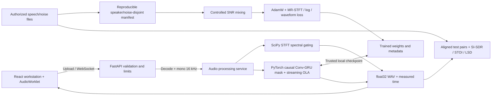
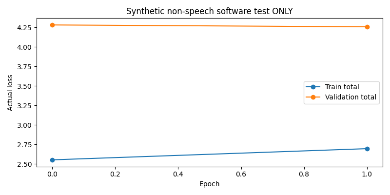
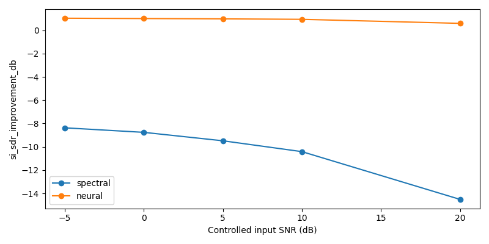
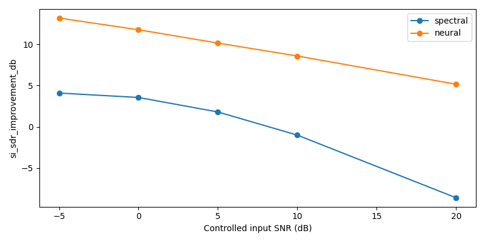

# AI Noise Suppression for Online Consultations

**ClearVoice AI (v0.1.0)**

**Project author / maintainer:** [AbinaSelvamurugan](https://github.com/AbinaSelvamurugan).

A speech-enhancement platform built with PyTorch, SciPy, FastAPI, and React/TypeScript. It pairs a classical spectral gate with a compact causal convolutional-recurrent network, and covers file processing, before/after playback, spectrograms, a clean-reference evaluator, a same-input comparison export, and WebSocket live microphone monitoring.

> **Medical/counselling safety:** This is not a medical device, transcription tool, diagnostic system, or certified privacy/compliance solution. Noise reduction can erase quiet words, introduce artifacts, or change perceived speech. Do not treat enhanced audio as a verbatim record. Obtain consent before recording consultation audio. Do not use sensitive consultation audio as training data without authorization.

## Architecture



The design goal is to preserve speech intelligibility and naturalness rather than maximize attenuation. Acceptance measurements include SI-SDR improvement, STOI where valid, real-time factor, duration preservation, and human listening checks. The neural model is trainable from scratch and ships without pretrained speech weights; the serving UI exposes neural enhancement once a compatible `best.pt` checkpoint is installed.

## Project map

- `src/consult_audio/audio.py`: robust SoundFile decoding, validation, mono policy, polyphase resampling, 32-bit float WAV.
- `src/consult_audio/spectral.py`: configurable median noise estimation, STFT mask, frequency/time smoothing, inverse STFT.
- `src/consult_audio/model.py`: 131,193-parameter default Conv1d/GRU neural gain-mask estimator, typed feature contract.
- `src/consult_audio/stream.py`: streaming 512/128-sample STFT, overlap/add power normalization and recurrent-state continuity.
- `src/consult_audio/data.py`: filesystem integrity validation, disjoint speaker/noise splits, deterministic paired SNR mixtures.
- `src/consult_audio/training.py`: batched training/validation, multi-component losses, finiteness and norm checks, best/last checkpoints.
- `src/consult_audio/checkpoint.py`: atomic trusted checkpoint saving and strict architecture/preprocessing loading.
- `src/consult_audio/metrics.py`, `benchmark.py`: clean-reference-only objective metrics, raw records, plots and CSV/JSON.
- `backend/app/main.py`: REST/WS service, fixed resource limits, in-memory uploads, model registry and OpenAPI.
- `frontend/src/App.tsx`: dashboard, studio, model comparison, live microphone, evaluation and settings UI.
- `frontend/public/audio-worklet.js`: browser capture/playback on an AudioWorklet; `frontend/src/audio/`: capture, streaming, difference audio.
- `scripts/`: fixture, manifest, train, CLI inference, paired listening export, loss plotting, benchmark/evaluate entry points. `tests/`: deterministic processing tests.
- `docs/`: methodology, datasets, training, evaluation, architecture, deployment, privacy and engineering notes.

## Prerequisites and installation

Recommended Python 3.11 or 3.12 (the project also declares 3.13), Node.js 22, npm 10, and libsndfile. Dependency versions are exact-pinned in `pyproject.toml` and `frontend/package.json`.

Linux/macOS (from project root):

```bash
python3.11 -m venv .venv
source .venv/bin/activate
python -m pip install --upgrade pip
python -m pip install -e '.[evaluation,quality]'
cp .env.example .env  # optional: export variables from .env when starting
python -m pytest -q
# terminal 1, project root:
PYTHONPATH=src:. uvicorn backend.app.main:app --host 127.0.0.1 --port 8000
# terminal 2:
cd frontend
npm install
npm run dev
```

Browse `http://localhost:5173`. Swagger/OpenAPI is available at `http://localhost:8000/docs`. From the project root `python -m pip install -e .` configures Python imports so `PYTHONPATH` is normally unnecessary; the explicit setting in the examples supports source-checkout execution.

Windows PowerShell:

```powershell
py -3.11 -m venv .venv
.\.venv\Scripts\Activate.ps1
python -m pip install -e ".[evaluation,quality]"
$env:PYTHONPATH="src;."
python -m uvicorn backend.app.main:app --host 127.0.0.1 --port 8000
# in a separate PowerShell terminal: cd frontend; npm install; npm run dev
```

**Privacy:** API defaults to processing uploads only in RAM; no uploaded bytes are written to persistent storage. The web frontend holds microphone data in volatile buffers for recording/streaming. In a shared/cloud deployment add authentication, HTTPS/WSS, consent/retention policy, load testing, and a security review. CORS and WebSocket origins default to localhost:5173. Environment variables: `CONSULT_CORS_ORIGINS`, `CONSULT_CHECKPOINT_DIR`, `CONSULT_MAX_UPLOAD_MB`, `CONSULT_MAX_DURATION_S`, `CONSULT_MAX_CONCURRENT`, `CONSULT_DEVICE`.

## Synthetic fixtures

```bash
python scripts/generate_fixture.py
python scripts/prepare_dataset.py --root data/synthetic --output artifacts/manifest.jsonl
python scripts/train.py --root data/synthetic --manifest artifacts/manifest.jsonl \
  --output artifacts/software-test-run --epochs 1
python scripts/benchmark.py --root data/synthetic --manifest artifacts/manifest.jsonl \
  --output artifacts/software-test-benchmark --max-examples 2
# export processed examples for the UI
python scripts/listen_example.py --root data/synthetic --manifest artifacts/manifest.jsonl \
  --output artifacts/listening-example --split test --snr-db 0
python scripts/infer.py --input artifacts/listening-example/noisy.wav \
  --output artifacts/listening-example/cli-enhanced.wav
```

The bundled `data/synthetic/` audio is a generated test fixture: computer-generated harmonic tones and noise rather than human speech. It exists so the dataset, training, checkpoint and evaluation code paths can be exercised end to end. For real use, install a checkpoint trained on licensed speech in the directory named by `CONSULT_CHECKPOINT_DIR`.

## Real dataset training

Obtain and license clean speech and environmental noise independently. A supported arrangement is:

```text
data/authorized/
  clean/
    speaker_001/*.wav
    speaker_002/*.wav
    speaker_003/*.wav
    ...
  noise/
    source_001.wav
    source_002.wav
    ...
```

At least three distinct speakers and three separate noise files are required (many more recommended). The directory structure and exact speaker IDs determine speaker-independent splits. A seeded permutation partitions speakers and noise files independently into train/validation/test and checks clean/noise SHA-256 overlaps. The split needs enough speakers and noise files to yield meaningful validation and test partitions. Clean/noise file manifests are per-example, not per observed speech/noisy sample.

```bash
python scripts/prepare_dataset.py --root data/authorized --output artifacts/authorized-manifest.jsonl
python scripts/train.py --root data/authorized --manifest artifacts/authorized-manifest.jsonl \
 --output artifacts/checkpoints --epochs 40 --device cpu
# Resume using optimizer and scheduler state:
python scripts/train.py --root data/authorized --manifest artifacts/authorized-manifest.jsonl \
 --output artifacts/checkpoints --epochs 60 --resume artifacts/checkpoints/last.pt
# Restart the API process after installing best.pt.
```

Noise is mixed with speech at sampled **−5 to +20 dB SNR** (configurable through the Python dataset API). User uploads are not assumed to be clean sources. Keep training material isolated from sensitive recordings by default.

Speech dataset options and licensing restrictions: [Microsoft DNS Challenge repository](https://github.com/microsoft/DNS-Challenge) lists the constituent dataset-specific terms (not one universal license). DNS5 fullband is enormous, so do not assume a practical local download; [VoiceBank/VCTK](https://datashare.ed.ac.uk/handle/10283/2791) and properly licensed [DEMAND](https://zenodo.org/records/1227121) subsets may be viable with attention to their particular terms. Cite the original corpora and challenge authors in any publication; consult `docs/dataset.md`. No third-party corpora or pretrained speech-model weights are redistributed.

## Inference APIs

```bash
curl -fsS http://localhost:8000/api/health
curl -fsS http://localhost:8000/api/models
curl -f -X POST http://localhost:8000/api/enhance \
  -F 'file=@my-noisy-audio.wav' \
  -F 'options={"method":"spectral","strength":1.4,"noise_seconds":0.35}' \
  --output enhanced.wav
curl -f -X POST http://localhost:8000/api/compare \
  -F 'file=@my-noisy-audio.wav' --output comparison.zip
curl -f -X POST http://localhost:8000/api/evaluate \
  -F 'noisy=@my-noisy-audio.wav' -F 'reference=@my-aligned-clean.wav' \
  -F 'options={"method":"spectral"}'
```

`/api/enhance` returns a float32 WAV; the `X-Audio-Metadata` HTTP header reports measured processing time and real-time factor. `compare.zip` contains `original.wav`, the algorithm WAV outputs where available, and `measurements.json`. `/api/analyze` returns up to 400 waveform columns and a bounded 129×120 dB spectrogram. `/api/training/status` reports the trainer state, which runs offline and separate from the serving process. `/api/live` accepts an initial JSON handshake and then 1024-sample 16-kHz mono float32 packets prefixed by uint32 sequence IDs; its responses prepend the sequence ID and a float32 server turnaround measurement, then valid PCM samples. The user interface implements the binary protocol.

Without a neural checkpoint installed, the API returns HTTP 503 on neural requests while spectral enhancement remains functional; no randomly initialized weights are substituted. Files are rejected unless they decode as WAV, FLAC, or OGG; max defaults are 20 MiB and 120 seconds.

## Evaluation and benchmark

```bash
python scripts/benchmark.py --root data/authorized \
  --manifest artifacts/authorized-manifest.jsonl --checkpoint artifacts/checkpoints/best.pt \
  --output artifacts/benchmark-real --max-examples 100 --device cpu
# For CUDA on a CUDA-enabled machine with compatible PyTorch:
python scripts/benchmark.py --root data/authorized \
  --manifest artifacts/authorized-manifest.jsonl --checkpoint artifacts/checkpoints/best.pt \
  --output artifacts/benchmark-cuda --max-examples 100 --device cuda
```

Outputs: per-example `results.json`, `results.csv`, `summary.csv`, SI-SDR improvement, measured latency and RTF per-SNR PNG plots plus summary.csv. The metrics require correctly aligned clean ground truth. SI-SDR is scale invariant but changes with alignment; STOI is optional and computed only at supported rates and durations; PESQ is disabled until licensing and a compatible evaluator are established. See `docs/evaluation.md` for interpretations, and compare models only on identical test segments and settings. The browser evaluation view supports JSON/CSV exports and importing `history.csv` loss curves.

## Quality, CI, and Docker

```bash
python -m pytest -q
ruff check src backend scripts tests
ruff format --check src backend scripts tests
# Frontend:
cd frontend && npm run build && npm test
# Docker:
docker compose up --build
```

The Compose deployment exposes the frontend on `http://localhost:5173` and the backend on `http://localhost:8000`. Remote public hosting requires HTTPS/WSS, authenticated users, and stronger operational controls. See `docs/deployment.md`.

## Technical limitations

- No speech-trained neural weights are shipped; neural enhancement in the UI requires a checkpoint trained on licensed speech.
- First 0.35 s is treated as noise-only by default; if speech is present, the mask may remove speech harmonics. Choose a noise-only segment.
- The streaming baseline uses the initial 0.35 s as evolving calibration and differs intentionally from offline median spectral gating, so its output can differ from the offline results.
- 16 kHz processing, stereo-to-mono averaging, with no multi-speaker separation or dereverberation.
- Browser live packet-turnaround timing reflects server turnaround, not end-to-end acoustic latency; output depends on browser resampling, jitter buffer, driver and hardware.
- Residual playback is the difference between the browser-resampled original and the enhanced WAV, not isolated noise.
- Not a substitute for clinician judgment or a guarantee of accurate speech communication.

## Documentation

`docs/architecture.md`, `docs/methodology.md`, `docs/dataset.md`, `docs/training.md`, `docs/evaluation.md`, `docs/deployment.md`, `docs/troubleshooting.md`, `docs/limitations.md`, `docs/engineering-notes.md`.

## License

Software: MIT (`LICENSE`). External datasets, references and PyTorch dependencies retain their own licenses. See `docs/dataset.md` before redistributing recordings.

## Bundled artifacts

Generated artifacts from the synthetic fixture are checked in for reference.

| Artifact | Contents |
|---|---|
| [Synthetic training history](artifacts/verification/synthetic_training_history.csv) | Loss per synthetic training epoch |
| [Synthetic benchmark results](artifacts/verification/synthetic_benchmark_results.json) | Per-example synthetic measurements |
| [Synthetic benchmark summary](artifacts/verification/synthetic_benchmark_summary.csv) | Grouped results, latency and real-time factor |
| [Synthetic listening files](artifacts/verification/synthetic_listening/) | Synthetic tones and enhancement outputs |
| [Training run log](artifacts/software-test-run/) | Training log and configuration |
| [Baseline benchmark](artifacts/software-test-benchmark/) | Plots and raw measurements |
| [Two-method benchmark](artifacts/software-test-benchmark-neural/) | Plots and raw measurements for the synthetic test pair |
| [Synthetic dataset](data/synthetic/) | Algorithmically generated audio |

### Training and timing visualizations





## Real-data run (30 December 2022)

Trained and benchmarked on a Modal H100 GPU using real, public recordings built by `scripts/build_real_dataset.py`:
LibriSpeech dev-clean + test-clean (80 speakers, 5,323 utterances, about 10.8 hours; CC BY 4.0) and eight DEMAND
noise environments (CC BY 4.0 per the Zenodo record). `scripts/prepare_dataset.py` split them by speaker and by noise
file: 56 / 12 / 12 speakers and 5 / 1 / 2 noise recordings for train / validation / test (3,611 / 856 / 856
utterances). **The test speakers and the two test noise recordings were never seen in training.**

Training settings used: `batch_size` 32 and `workers` 28 (the shipped config uses 4 and 0), mixed precision on CUDA,
otherwise `configs/training.yaml` and `configs/model.yaml`. The model (`ConvRecurrentMask`, 131,193 parameters) trained
for 37 epochs (early stopping) in 836 s; best validation loss 0.4447.

Benchmark (`scripts/benchmark.py`, 100 test clips per SNR, mean SI-SDR improvement in dB, ± 95% CI half-width):

| Input SNR | Spectral subtraction (baseline) | Neural model |
|-----------|-----|-----|
| -5 dB | +4.09 ± 0.90 | **+13.19 ± 1.28** |
| 0 dB | +3.56 ± 0.92 | **+11.77 ± 1.08** |
| 5 dB | +1.80 ± 1.03 | **+10.16 ± 0.90** |
| 10 dB | -1.01 ± 1.24 | **+8.59 ± 0.77** |
| 20 dB | -8.61 ± 1.66 | **+5.17 ± 0.67** |

The neural model improves SI-SDR at every noise level; the classical baseline degrades the signal at 10 and 20 dB.

Latency (per clip): spectral subtraction about 4 ms on CPU (real-time factor 0.004); neural model about 50 ms
(real-time factor about 0.05) measured on the H100, so CPU or edge latency has **not** been measured. SI-SDR is an
objective metric and is not a listening test; this project has not been evaluated with clinicians, patients or
human listeners.



Benchmark figures and `summary.csv` are committed under `artifacts/benchmark/`; the per-clip results and the trained
checkpoint (`artifacts/checkpoints/best.pt`) are not.

Fixed while running on real data: `src/consult_audio/training.py` no longer raises on infinite gradients when mixed
precision is on, because the gradient scaler skips those steps itself (training crashed in epoch 1 without this).
