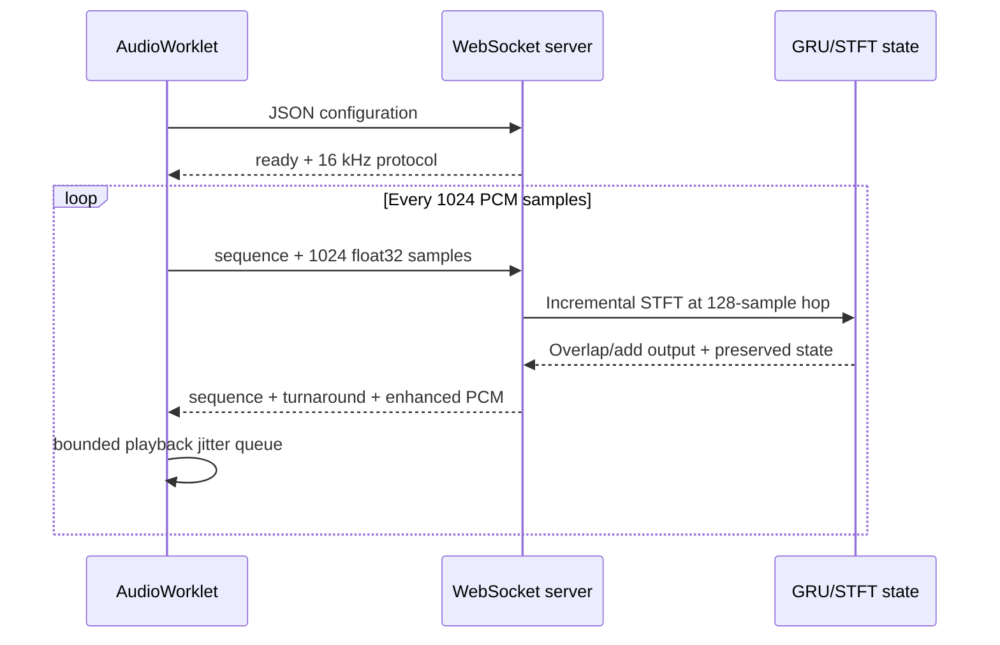

# Architecture and design record

## Chosen network

A compact convolutional recurrent frequency-gain model is preferred to a learned-filterbank recurrent architecture for this project. The 16 kHz STFT makes phase preservation and deterministic reconstruction straightforward. Two stride-2 frequency convolutions encode each 257-bin frame, a 96-unit GRU (one layer) models causal temporal evolution, and a sigmoid 257-gain head masks the complex observation. Default parameters: 131,193. The complex noisy phase is retained. Features are `log1p(abs(rfft(windowed_frame)))` with periodic sqrt-Hann window, FFT 512 and hop 128. **The waveform amplitude is not log-normalized**; gain masking is applied to the original complex STFT. The model is neither an RNNoise port nor pretrained.

Forward input: `[B,T,257]` float log magnitude; output: `[B,T,257]` real masks in `[0,1]`, plus GRU state `[num_layers,B,hidden]`. Neural file serving uses a shared model instance in eval mode and local streaming state per request. The training path uses centered padding for manageable waveform losses while inference uses causal front-padding 384 samples plus normalized overlap/add. Short-edge behavior therefore differs; document this when comparing training and live output.

Alternative considered: learned time-domain filterbank with recurrent gain estimation. It can reduce STFT phase limitations but introduces difficult trainable filterbank reconstruction, higher implementation complexity, and a separate causal state/latency design. A spectral mask provides an interpretable baseline with a predictable reconstruction path.

## Offline spectral pipeline

Input bytes → libsndfile decode → validate channels/rate/finite values/length → mono average → target 16 kHz using polyphase FIR → configured STFT → frame noise magnitude median over specified calibration interval → mask → separable Gaussian smoothing → inverse STFT → float WAV.

## Stateful streaming

512-sample FFT = 32 ms window; 128-sample hop = 8 ms. **These are algorithm frame settings.** The overlap/add implementation multiplies by sqrt-Hann on analysis and synthesis and divides by summed window power. It starts with 384 zero samples to give full frame context and discards 384 generated prefix samples. `finish()` adds zeros to restore exact length in offline mode; live mode does not flush artificial tail. GRU state persists across chunks. Offline spectral gating and live gating use different noise estimators (median vs causal moving estimate). A WebSocket packet is 4+4096 bytes; replies have 8-byte header and variable PCM length. A single connection is limited to 10 minutes, origin checked, malformed packet closes the connection.

## Security boundaries

Upload files never get user-supplied server paths; decoded in memory, size, duration, format, channel and sample rate checked. No audio content is logged. The server holds only locally provisioned checkpoints (loaded via PyTorch's `weights_only=True`), never user-supplied arbitrary serialized weights. CORS and WebSocket origins are constrained, but this local application **does not provide authentication, encryption on HTTP, DDoS defenses or a regulatory privacy certification**. Do not publicly expose it without additional controls.
